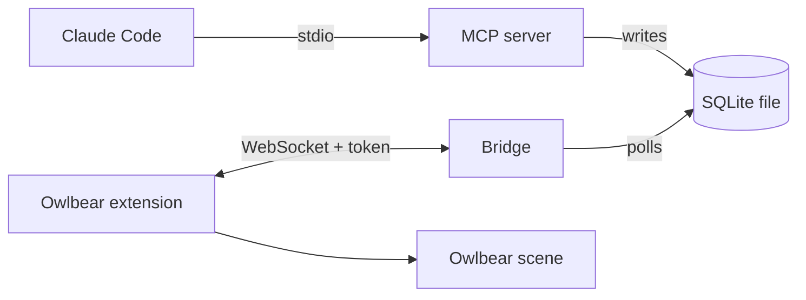

# Architecture (runtime view)

Which processes run, how they talk, and what reaches the table. For the package and dependency rules, see the Architecture section of [`CLAUDE.md`](../CLAUDE.md).

## Processes

- **MCP server**: stdio, started by Claude Code from `.mcp.json` through the launcher `packages/mcp/bin/stdio.mjs`.
- **Bridge**: `npm run bridge`, a separate process. HTTP plus WebSocket `/ws` on 127.0.0.1, default port 5199 (`BRIDGE_PORT`). It also serves the built extension (`packages/owlbear/dist`).
- **Extension**: runs in the GM's Owlbear tab and is the bridge's client.

## Shared database

Both processes use one SQLite file in WAL mode: `TTRPG_AGENTS_DB`, else `$XDG_DATA_HOME/ttrpg-agents/encounters.db`, else `~/.local/share/ttrpg-agents/encounters.db`. The MCP server writes; the bridge only reads.

## Token and auth

- The token file is `BRIDGE_TOKEN_FILE` (default `~/.config/ttrpg-agents/bridge-token`, mode 0600, created on first run).
- A `manifest.json` request with the right `?token=` gets the token put into the popover URL fragment. The extension reads it from `location.hash` and sends it in `hello`. The bridge compares it in constant time; a bad or missing token closes the socket.
- The Host header must be a loopback name with the actual port (DNS-rebinding defence), and the WebSocket upgrade must come from the bridge's own loopback origin on `/ws`.
- The `role` in `hello` only drives the extension UI and never authorizes.

## What reaches the table

The bridge polls `PRAGMA data_version` every 250 ms. When another process committed, it broadcasts an `encounter-snapshot` (the full instance list, HP included) to authenticated clients. It also sends one after each `hello-ack`.

Today the extension (GM role only) creates one hidden SHAPE token per instance (metadata key `com.ttrpg-agents/instance`) and deletes tokens for instances that are gone. It holds messages until the scene is ready, and a snapshot supersedes held ones. This is today's behaviour and may change (open ticket #96 changes the token).
