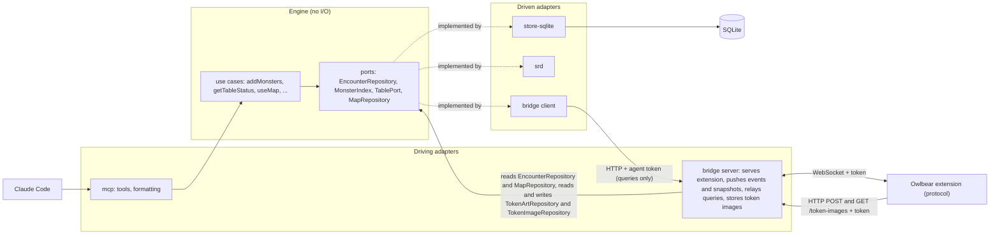
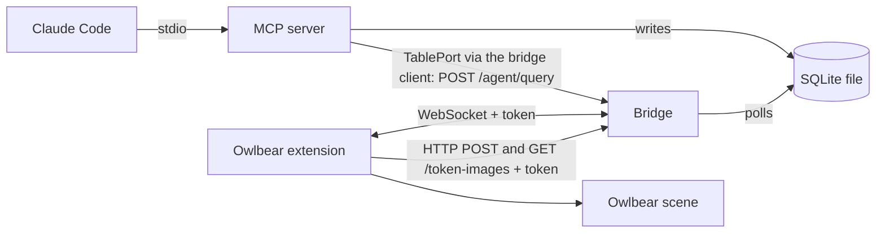

# Architecture

## Hexagon (packages and ports)

The packages and the ports between them. For the dependency rules, see the Architecture section of [`CLAUDE.md`](../CLAUDE.md).

The bridge is both sides. The server is a driving adapter: table edits become engine commands (an `instance-edit` runs the engine's `applyInstanceEdit`; a `token-deleted` calls `EncounterRepository.removeInstances` directly), and it reads the encounter through the `EncounterRepository` port and the token art through `TokenArtRepository` to build snapshots, polls the change log through the `EncounterLog` port to push events, reads the active map and its rooms through the `MapRepository` port to push `map-rooms`, and stores the art the extension sends. `POST /token-images` runs the engine's `storeTokenImage`, which validates the bytes and saves them through the `TokenImageRepository` port, and `GET /token-images/<sha256>` reads them back through the same port. The client is a driven adapter: the driven end of `TablePort`. The mcp-to-bridge arrow in the runtime diagram below is made by the bridge client adapter that `mcp/src/stdio.ts` wires in. The channel is read-only by rule: it carries queries only, and the agent changes the game through the engine's model (see the rule in [`CLAUDE.md`](../CLAUDE.md)).

## Runtime (processes)

Which processes run, how they talk, and what reaches the table.

## Processes

- **MCP server**: stdio, started by Claude Code from `.mcp.json` through the launcher `packages/mcp/bin/stdio.mjs`. It also calls the running bridge over loopback HTTP to ask the table something (see "Queries to the table").
- **Bridge**: `npm run bridge`, a separate process. HTTP plus WebSocket `/ws` on 127.0.0.1, default port 5199 (`BRIDGE_PORT`). Its HTTP routes are `POST /agent/query` (see "Queries to the table"), `POST /token-images` (the picked image's bytes from the extension, see "Token and auth"), `GET /token-images/<sha256>` (the stored bytes of one image, for the extension to upload to Owlbear again, see "Token and auth"), and the built extension (`packages/owlbear/dist`) for everything else.
- **Extension**: runs in the GM's Owlbear tab and is the bridge's client. After a pick it fetches the picked image from its Owlbear URL; before it creates tokens with stored art it checks once per session whether the art's URL still answers; and on connect it checks the URL of each art without stored bytes and, if it answers, fetches the image to store its bytes. For a `map-image` query it fetches the map image from its Owlbear URL.

## Shared database

Both processes use one SQLite file in WAL mode: `TTRPG_AGENTS_DB`, else `$XDG_DATA_HOME/ttrpg-agents/encounters.db`, else `~/.local/share/ttrpg-agents/encounters.db`. The MCP server writes. It also stores the map registrations (`use_map`, table `map_registrations`, migration 9): per map item id, its name and its transform when registered; one registration is the active map, and registering the same item again updates its row in place. It stores the rooms named on a map too (`set_rooms`, table `map_rooms`, migration 10): per map item id, each room's name, status and image-pixel polygons; re-registering the map keeps them, and `remove_rooms` deletes them. The bridge reads, removes one instance when the extension reports (`token-deleted`) that the GM deleted its token, applies HP, max HP, armor class and initiative edited on the table (`instance-edit`), and stores the image the GM picked for a monster type (`token-art-set`, table `token_art`). Validated image bytes live in table `token_art_image`, keyed by SHA-256, with no monster key or monster link. `token_art.sha256` is an optional link to one of those images; art without a stored image has it null. The bridge stores the picked image's bytes when the extension posts them (`POST /token-images`), and the extension links them with a second `token-art-set` carrying their `sha256`. A `token_art` row may have no url: stored bytes never published to Owlbear (for example from the local library import, #221). Its url, mime, width and height are all set or all null (migration 8), and a row without a url must link an image (`sha256`). The token art library import (`npm run import:token-art`, #221) is a third process on the same file: it stores validated image bytes in `token_art_image` and assigns them as URL-less `token_art` rows, and never overwrites art unless asked (`--replace`).

## Token and auth

- The token file is `BRIDGE_TOKEN_FILE` (default `~/.config/ttrpg-agents/bridge-token`, mode 0600, created on first run).
- A `manifest.json` request with the right `?token=` gets the token put into the popover URL fragment. The extension reads it from `location.hash` and sends it in `hello`. The bridge compares it in constant time; a bad or missing token closes the socket.
- The Host header must be a loopback name with the actual port (DNS-rebinding defence), and the WebSocket upgrade must come from the bridge's own loopback origin on `/ws`.
- The `role` in `hello` only drives the extension UI and never authorizes.
- A second, separate agent token authorises `POST /agent/query`: file `BRIDGE_AGENT_TOKEN_FILE` (default `~/.config/ttrpg-agents/agent-token`, mode 0600, created on first run). The bridge never serves it, it is not in the manifest URL, and it authorises nothing else. The extension token is rejected on that route.
- `POST /token-images` takes the extension token as `Authorization: Bearer <token>`, compared in constant time before the body is read; the agent token is refused. The body is the raw image, at most 1 MiB; its Content-Type is ignored, the bridge never reads a URL from it, and the route makes no outbound request. Refusals are typed JSON (`{ ok: false, error: { code, message } }`): 401 `unauthorized`, 413 `too_large`, 422 for bytes that fail validation (`svg`, `unsupported_type`, `unreadable`, `dimensions_too_large`), 500 `store_failed`. A wrong Host gets the plain 403 of the Host check. The route has no CORS headers: the panel is served by the bridge, so its upload is same-origin.
- `GET /token-images/<sha256>` takes the extension token as `Authorization: Bearer <token>`, compared in constant time before the hash is looked up; the agent token is refused. The rest of the path must be exactly 64 lowercase hex characters, with no query string. Refusals are typed JSON (`{ ok: false, error: { code, message } }`): 401 `unauthorized`, 404 `not_found` (a malformed hash or one the bridge does not hold). The answer is the stored bytes, read through `TokenImageRepository`, with the stored mime as Content-Type and `X-Content-Type-Options: nosniff`. A wrong Host gets the plain 403 of the Host check. The route has no CORS headers: the panel reads it same-origin.

## Queries to the table

Apart from the extension's write-backs (`token-deleted`, `instance-edit`, `token-art-set`), image uploads (`POST /token-images`) and image reads (`GET /token-images/<sha256>`), the bridge only pushes. To let the agent ask the table something (first use: `table_status`), the MCP tool calls the engine's `getTableStatus`, which asks the `TablePort`; the bridge client (`@ttrpg-agents/bridge/client`, wired in by `mcp/src/stdio.ts`) implements the port and calls `POST /agent/query` on the bridge with `Authorization: Bearer <agent token>` and a JSON query (`{"name":"scene-status"}`). The channel is read-only by rule: a query never changes the table. The route has no CORS headers, keeps the Host check, and caps the body at 1 MiB.

1. The bridge sends the query as a `query` message with a fresh id to the one active extension client.
2. The extension answers with a `query-result` carrying the same id (or a non-fatal `error` with that id if the handler threw). A reply with another or no id does not complete the call; the bridge answers it with a non-fatal `error`.
3. The bridge returns the result as the HTTP body: `{ ok: true, result }` or `{ ok: false, error: { code, message } }`.

Errors: 401 `unauthorized`, 400 `bad-request`, 503 `not-connected` (no GM tab), 504 `timeout` (no reply within 5 s; 30 s for `map-image`), 502 `query-failed`. The bridge client adds `bridge-unreachable` when the bridge is not running or the agent token file is missing; the adapter (`createBridgeTable`) turns any `{ ok: false }` into a `TableUnavailableError`. Only one GM tab is connected at a time, so there is one recipient.

`scene-status` returns whether the scene is ready, how many of our tokens are on it, and how many instances the extension has applied. `getTableStatus` (engine) compares those with the encounter in the database to give the in-sync verdict; `table_status` only formats it.

`scene-map` returns the scene grid (dpi and type) and, for each image on the map layer, its id, name, image size, image grid (dpi and offset) and transform (position, rotation, scale). On a scene that is not ready the extension's reads fail and the reply is `query-failed`. The engine's `useMap` (the `use_map` tool) uses it: it rejects a grid that is not square, picks the map, and stores the map's transform and the scene dpi through the `MapRepository` port. The engine's `setRooms` and `listRooms` (the `set_rooms` and `list_rooms` tools) read it to convert display cells with the active map's live transform, and say when the map moved since it was registered; `removeRooms` (`remove_rooms`) does not ask the table.

`scene-tokens` returns the axis-aligned bounds (scene units) of every item on the `CHARACTER` and `MOUNT` layers, hidden ones and our own tokens included, whatever their metadata; the extension reads them with Owlbear's `getItemBounds`, one call per item. On a scene that is not ready, or when a bounds read fails, the reply is `query-failed`. The engine's room placement for `add_monsters` (#50) reads it with `scene-map` and treats every cell whose centre lies inside or on the edge of a token's bounds as occupied.

`map-image` (`{"name":"map-image","itemId":"..."}`) takes a map item id and returns that map image as the DM sees it (rotation and scale applied), with the engine's display grid drawn over it: cell lines, and column letters and row numbers on all four edges in a one-cell margin. The picture is downscaled to a long side of at most 1600 px and encoded as WEBP (JPEG where the browser cannot encode WEBP) at decreasing quality until its base64 fits under the 1 MiB message cap (`MAX_MESSAGE_BYTES`); the reply carries its mime type, base64 data and pixel size. The grid size comes from the engine, not from this reply. The extension fetches the image from its Owlbear URL and draws it on an offscreen canvas, so nothing is written to the scene. An id that is not a map image on the scene, or an image that does not fit at the lowest quality, is `query-failed`. The bridge waits up to 30 s for this reply (`mapImageTimeoutMs`), because fetching and encoding can take longer than 5 s. The engine's `getMapImage` (the `get_map_image` tool) reads it for the map in use, after `scene-map` (it fails like `list_rooms` when no map is in use, the map is gone or the grid is not square) and reports the display grid size itself; the agent reads room interiors from the image, and the engine's `proposeRooms` (`propose_rooms`, which asks the table nothing) shrinks them into proposals.

## What reaches the table

The bridge polls the change log every 250 ms and broadcasts each new event to authenticated clients as an `encounter-event` carrying its `seq`, oldest first. Only events committed after the bridge started are read. The poll sees every commit, the MCP server's and the bridge's own write-backs. A row the bridge cannot parse (for example one written by a newer MCP server) comes back from `EncounterLog.eventsSince` as an unreadable entry in its place; the bridge reports it once and sends every client a snapshot instead.

A client that connects gets an `encounter-snapshot` (the full instance list, HP included, plus the `seq` it is current as of) after the `hello-ack`. The extension's own commands (`instance-edit`, `token-deleted`, `token-art-set`) get no snapshot in reply: the `table` events of an accepted edit or removal carry its envelope id as their command id and are its answer, and a refusal is a non-fatal `error` with that id. A `token-art-set` gets no answer when accepted (it has no envelope id); a failed write is a non-fatal `token-art-failed` `error` without one. There is no resume: a client that reconnects gets a new snapshot.

The extension (GM role only) reconciles the scene against the latest encounter. It keeps the instances from the last snapshot, folded with later events of both origins in `seq` order, and fixes the difference with the scene on every snapshot, applied event, scene-ready change and retry after a failed apply (backoff). It ignores an event it already has (a `seq` at or before the last one). It applies deltas by origin: an `mcp` event writes the fields it changes to the table, and a `table` event is the store's answer to a command (see the rules below). When an event skips a `seq`, it applies nothing and reconnects for a snapshot. Nothing touches the scene until it is ready.

- **Tokens.** Our tokens carry the metadata key `com.ttrpg-agents/instance`; anything else on the scene is never touched. By default each instance is a hidden IMAGE token drawn with the art the GM picked from their Owlbear asset library for its monster type (asked once per type, when a token is first created for it, then remembered in the database as a VTT-neutral reference `{ url, mime, width, height }`; the extension derives an Owlbear grid with the image centred when it creates the token, its longer side spanning the instance's footprint in cells), or a hidden circle SHAPE token when there is no art (no usable pick: cancel, picker error or invalid image). After a pick the extension fetches the picked image and uploads its bytes to the bridge (`POST /token-images`) without delaying the pick or the tokens; once they are stored it sends the art again with their `sha256`. Each pick gets one attempt: a failed fetch or upload keeps the art as a link and shows in the panel until it reloads (a later failure replaces it). Art that has a URL and no stored bytes (picked before bytes were stored, or whose upload failed) gets them on connect: once per type per session, for every such row whether or not its type gets tokens, the extension checks whether its URL still answers and, if so, fetches and uploads the image as after a pick, with no GM dialog; a failure shows in the panel the same way, and a gone URL, or a check that cannot tell, leaves the art as it is. Stored art whose Owlbear asset is gone is published again: once per type per session, before tokens are created for a type whose art has stored bytes (and was neither picked nor checked on connect this session), the extension checks whether the art's URL still answers; a check that cannot tell keeps the stored art. For a gone URL it reads the stored bytes from the bridge (`GET /token-images/<sha256>`) and uploads them to the GM's asset library under the name `ttrpg-art-<first 16 hex of the hash>`; the GM confirms the folder in Owlbear's upload dialog, presses "Pick the uploaded image" in the panel and picks that image in the picker, which opens with the name as its search. The pick replaces the art's reference and keeps its `sha256`. Bytes that cannot be read (shown in the panel until it reloads), a failed upload or no usable pick keep the stored art and make the type's tokens circles for the session. Stored art without a url (bytes never published) is published the same way when its type first gets tokens, with no liveness check: upload, panel button, then the pick with the name as its search, which completes the row with the same `sha256`. The extension never draws such art and never opens a fresh picker for its type: until the pick, or for the session after a cancel or failure, the type's tokens are circles. The engine sets each instance's footprint from its monster's size category (small and medium 1 cell, large 2, huge 3, gargantuan 4; tiny and unknown sizes 1), and the store keeps it per instance (rows from before it existed read as 1). A new hidden circle is footprint cells wide and high. A new token is created at its instance's spawn position when it has one (an `add_monsters` group with a room); the others of one batch sit side by side in the default row near the viewport centre, each in a slot as wide as its footprint. An existing token is moved once when `move_monsters` sets a new spawn position for its instance (or a snapshot shows one the token was not yet moved to); such a move over a token the table had moved, or with no record of where the extension placed it, is listed in the panel's override list. Tokens that already exist are never resized or re-skinned. Per-feature values are set by projectors (`owned` or `create-only`) and written one metadata key at a time, so other extensions' keys survive.
- **Only the MCP writes the table.** Each token records the value last written for every `owned` key (metadata key `com.ttrpg-agents/synced`). A value is pushed only when the encounter changed since then. A table edit stands until the encounter's value changes again, and then the encounter overwrites it. An edit of HP, max HP, armor class or the tracker's initiative `count` is also written back (`instance-edit`, one command per field), and these fields are decided one by one. A write-back is sent only after the value has stayed unchanged for 1.5 s (a later value restarts the delay; an `mcp` change of the field meanwhile drops the held edit), and an unreadable value is reported in the panel only if it is still unreadable after the same delay. Removing a token from the tracker clears the instance's initiative, and a count on a token whose instance has none is adopted. The table is written only for a store change caused by the MCP: an `mcp` event that changes a field pushes it, even over a table edit, unless an edit of that field is still queued or unacknowledged (that edit commits after the event, so the store ends at the typed value too). The answer to an edit (its `table` event) never writes the field it set to the table: the token keeps the typed value and the baseline records it, so a clamp is not sent again (the panel shows a note), and a refusal is recorded the same way and shows the error. A field the edit did not set that the store changed (HP lowered by a max HP edit) is pushed. A `table` event with a command id the extension does not know (one sent before a reload) records the store's values as the baseline. A snapshot (connect, reconnect after a gap, or in place of an unreadable change-log row on the same connection) pushes each field whose store value differs from the baseline, unless an edit of it is in flight, so a clamped value kept on the table gives way to the store's at the next snapshot. Each such push over a different token value is listed in the panel (instance, field, the table's value and the store's) until the DM dismisses the list, because a snapshot cannot tell an MCP change made meanwhile from an overridden clamp; the list is kept in memory only. A snapshot on the same connection may cover the answers of edits already sent, which then never arrive, so the extension forgets those edits; one the store has not applied yet is sent again (edits are absolute). After a reload a typed value the store does not hold is sent again, unless the store's value changed since the last write.
- **Commands wait for the bridge.** A table edit, token deletion or art pick made while the socket is down is queued in the extension (the panel counts what waits) and sent in order after the next `hello-ack`, before the snapshot that follows is applied. A command is remembered until its `table` event or refusal arrives; one sent on a connection that has since dropped is forgotten at the next snapshot, so a lost one is noticed and sent again. An art pick gets no answer, so it is forgotten at the snapshot that follows the next `hello-ack` and is not sent again; a pick lost in flight (taken by the socket but never stored) is not resent.
- **Table edits settle before they are written back.** Every edit field (HP, max HP, armor class, initiative) is sent only after its value has stayed unchanged for 1.5 s, and an unreadable value is reported only if it is still unreadable then. This applies to all fields on purpose: the Initiative Tracker writes `count` on every keystroke (an empty box included), while Stat Bubbles writes once on Enter or blur (both measured 2026-10-25), and one rule covers any extension added later without checking how it writes.
- **Deleted tokens stay deleted.** The scene metadata key `com.ttrpg-agents/placed` lists the instances already placed on the scene, so a token the GM deleted is not recreated. A scene with no record is populated.
- **Token deletion is written back.** A deleted token (a wanted instance in `placed` with no token) is reported to the bridge, which removes the instance from the store. The `table` event for the removal acknowledges the command and removes the instance from the extension's encounter, so the `placed` record is pruned. A deletion in flight is not reported again.
- **Map overlay.** The extension (GM role only) draws, as local items (`OBR.scene.local`: per client, not synced to players, not saved with the scene), the display grid's column letters along the top edge and row numbers along the left edge with a tick per cell, and each saved room's outline with its name (proposed rooms dashed and marked "(proposed)"). It is read-only: its items are locked and not selectable, and corrections happen in chat. It comes from the bridge's `map-rooms` message (the active map's item id and rooms, polled every 250 ms and sent on change and after each `hello-ack`, after the snapshot; no active map sends an empty list) and the map item's live transform. It is redrawn when the rooms change or the map item moves or scales, and removed when the map item is gone, no map is in use, the grid is not square, or the DM turns it off with the panel's "Show map grid and rooms" toggle (on by default, not saved). Its items carry `com.ttrpg-agents/overlay`, and it only ever removes its own items.

### Who owns what

Per synced value: which side has authority, and how a change on the other side reaches it. A feature that syncs a new value adds a row here in its plan.

| Value                                                | Authority                                                                                                                                                                                  | Table change reaches the store                                                                                                                                                                                                   | Store change reaches the table                                                                                                                                                                                                                            |
| ---------------------------------------------------- | ------------------------------------------------------------------------------------------------------------------------------------------------------------------------------------------ | -------------------------------------------------------------------------------------------------------------------------------------------------------------------------------------------------------------------------------- | --------------------------------------------------------------------------------------------------------------------------------------------------------------------------------------------------------------------------------------------------------- |
| Instance existence                                   | store                                                                                                                                                                                      | A GM token deletion is written back (`token-deleted`); a deleted token is not recreated (`placed`).                                                                                                                              | A token is created for an instance not in `placed`.                                                                                                                                                                                                       |
| HP, max HP, armor class (Stat Bubbles)               | shared                                                                                                                                                                                     | Written back (`instance-edit`) after it has stayed unchanged for 1.5 s; an armor class only when the instance has one.                                                                                                           | Pushed per field for an `mcp` event that changes it, unless an edit of it is in flight; a snapshot pushes a value that differs from the baseline and lists it in the panel.                                                                               |
| Initiative `count`                                   | shared                                                                                                                                                                                     | Written back (`instance-edit`) after it has stayed unchanged for 1.5 s; a token removed from the tracker clears it, and a count for a monster with none is adopted.                                                              | Pushed for an `mcp` event that changes it, unless an edit of it is in flight; a snapshot pushes a value that differs from the baseline and lists it in the panel.                                                                                         |
| Initiative Tracker `active` flag                     | table                                                                                                                                                                                      | Never.                                                                                                                                                                                                                           | Never; carried over from the token's value.                                                                                                                                                                                                               |
| Stat Bubbles `hide`                                  | store                                                                                                                                                                                      | Never.                                                                                                                                                                                                                           | Set from `statsVisible`; a table edit stands until `statsVisible` changes.                                                                                                                                                                                |
| Token name                                           | store (rename tool)                                                                                                                                                                        | Never.                                                                                                                                                                                                                           | Pushed on a rename; a table rename stands until the store renames again.                                                                                                                                                                                  |
| Token position                                       | table, after creation; the store holds the spawn position, which `move_monsters` may set again                                                                                             | Never.                                                                                                                                                                                                                           | Created at the spawn position when it has one, else in the default row; an existing token is moved once to a new spawn position set by `move_monsters` (or seen in a snapshot), and listed in the panel when the table had, or may have, moved it.        |
| Visibility, size and art of a token                  | table, after creation                                                                                                                                                                      | Never.                                                                                                                                                                                                                           | Create-only: set when a new token is created; never written to an existing token.                                                                                                                                                                         |
| Token art per monster type                           | table picks, store remembers; the store may hold art never published (bytes only), which the table's first publish completes; the library import (#221) also sets art (bytes only, no url) | `token-art-set`, plus the image bytes by `POST /token-images` and a second `token-art-set` with their hash. A republish (the asset is gone) or a first publish (the art has no url) sends the picked art with the existing hash. | Used when a token is created for the type; art without a url is published first, and its tokens are circles until then (or for the session after a cancel); art the library import writes reaches a running extension only after the Owlbear tab reloads. |
| Map item transform                                   | table                                                                                                                                                                                      | Never automatically; read by the `scene-map` query, and stored as the map's registration when the DM says to use the map (`use_map`); read live by `set_rooms` and `list_rooms`.                                                 | Never.                                                                                                                                                                                                                                                    |
| Rooms                                                | store                                                                                                                                                                                      | Never.                                                                                                                                                                                                                           | Pushed to the extension as `map-rooms` on change and after each `hello-ack`, and drawn as the local, read-only overlay; nothing is written to the scene.                                                                                                  |
| `com.ttrpg-agents/synced`, `com.ttrpg-agents/placed` | the extension's own bookkeeping                                                                                                                                                            | Never.                                                                                                                                                                                                                           | Never.                                                                                                                                                                                                                                                    |

### Change origin

Every change to the store carries an origin (`mcp` or `table`) and a command id. A consumer applies changes from other origins and treats changes from its own commands as acknowledgements. A consumer never writes a value to the table because the store's answer differs from what it asked: no clamp push-back and no refusal push-back (the #204 rule, stated for the general case). The one exception is a snapshot: it has no origin, so it writes the store's value over a value kept on the token (a clamp or a refusal) and the extension lists each such write in the panel's override list (#209, option (a), decided by Tony).

- In force: the #204 rule. The table is written only for a store change caused by the MCP, or by a snapshot (the exception above); the answer to an edit (the `table` event carrying its command id) never writes the field it set to the table.
- In force (#208, engine): every repository mutation takes a `ChangeOrigin`, and `encounterEventSchema` has an origin-carrying event for each mutation. The store records each event, with its origin, in an ordered log (`encounter_events`, read through the engine's `EncounterLog` port; #128), and the bridge polls it (#224).
- In force (#224, #209, bridge and extension): the bridge broadcasts the log as ordered `encounter-event`s with `seq`; a snapshot carries the `seq` it is current as of and is sent on connect (or in place of an unreadable row), never as the answer to a command. The extension applies events in `seq` order by origin, ignores duplicates, and reconnects for a snapshot on a gap; it treats the `table` events of its own commands as acknowledgements and queues commands while the socket is down.
