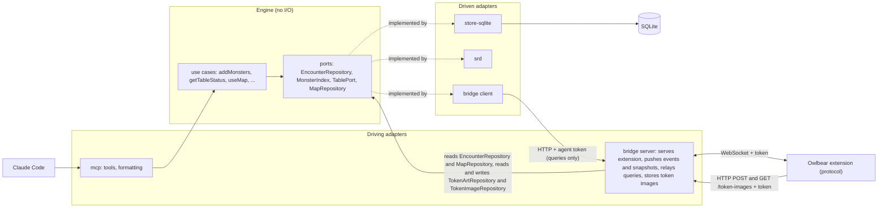
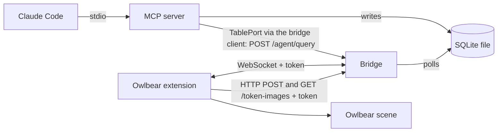

# Architecture

The runtime view: processes, ports, auth, data flow, and the rules for what reaches the table. Mechanics live in the package READMEs, history in [`docs/decisions/`](decisions/README.md).

## Hexagon (packages and ports)

The packages and the ports between them. For the dependency rules, see the Architecture section of [`CLAUDE.md`](../CLAUDE.md).

The bridge is both sides. Its server is a driving adapter: a table edit becomes an engine command (`instance-edit` runs `applyInstanceEdit`, `token-deleted` calls `EncounterRepository.removeInstances`), snapshots come from `EncounterRepository` and `TokenArtRepository`, events from `EncounterLog`, the active map and its rooms from `MapRepository`, and the token image routes run the engine's `storeTokenImage` over `TokenImageRepository`. Its client is a driven adapter, the driven end of `TablePort`, wired in by `mcp/src/stdio.ts`. That channel carries queries only: the agent changes the game through the engine's model (the rule is in `CLAUDE.md`).

## Runtime (processes)

Which processes run and how they talk.

## Processes

- **MCP server**: stdio, started by Claude Code from `.mcp.json` through `packages/mcp/bin/stdio.mjs`. It writes the database and asks the table through the bridge (see "Queries to the table").
- **Bridge**: `npm run bridge`, a separate process on 127.0.0.1, default port 5199 (`BRIDGE_PORT`): HTTP plus WebSocket `/ws`. Its routes are `POST /agent/query` (the agent's queries), `POST /token-images` and `GET /token-images/<sha256>` (token art bytes, see "Token and auth"), and the built extension (`packages/owlbear/dist`) for everything else. Bodies, timeouts and refusals: [`packages/bridge/README.md`](../packages/bridge/README.md).
- **Extension**: runs in the GM's Owlbear tab as the bridge's client, reconciles the scene to the encounter and answers the agent's queries. It fetches images from Owlbear for token art and for the `map-image` query. Mechanics: [`packages/owlbear/README.md`](../packages/owlbear/README.md).
- **Token art library import** (`npm run import:token-art`): a third, occasional process on the same database. See [`packages/store-sqlite/README.md`](../packages/store-sqlite/README.md), Token art library.

## Shared database

One SQLite file in WAL mode: `TTRPG_AGENTS_DB`, else `$XDG_DATA_HOME/ttrpg-agents/encounters.db`, else `~/.local/share/ttrpg-agents/encounters.db`. The schema is versioned in `packages/store-sqlite/src/migrations.ts`.

| Data                                                                                  | Written by                                                                                         | Read by                                    |
| ------------------------------------------------------------------------------------- | -------------------------------------------------------------------------------------------------- | ------------------------------------------ |
| Encounter (`monster_instances`, `encounters`) and its change log (`encounter_events`) | MCP server; the bridge for a table edit (`instance-edit`) or a GM token deletion (`token-deleted`) | bridge (event poll, snapshots); MCP server |
| Undo records (`undo_commands`, `undo_instances`)                                      | MCP server, one record per MCP command that changed the encounter                                  | MCP server (`undo`)                        |
| Map registrations (`map_registrations`) and rooms (`map_rooms`)                       | MCP server (`use_map`, `set_rooms`, `remove_rooms`)                                                | bridge (`map-rooms` push); MCP server      |
| Token art per monster type (`token_art`)                                              | bridge (`token-art-set`); the library import                                                       | bridge (snapshots)                         |
| Token image bytes (`token_art_image`, keyed by SHA-256)                               | bridge (`POST /token-images`); the library import                                                  | bridge (`GET /token-images/<sha256>`)      |

Invariants the processes rely on:

- A removed instance keeps its row, marked removed, so `restore_monsters` puts it back with its id and state. A clear keeps the set it removed for `restore_encounter` and deletes the instances removed before it: only the last clear's set is restorable.
- A restore records, on each instance it puts back, the `seq` of the `added` event it logs. It is kept while the instance stays in the encounter and replaced by a later restore; snapshots carry it.
- An undo record holds each instance's state before the command's first write to it. A map or room change leaves a record with no instances, so `undo` can say it does not cover it; table changes leave none; a clear that clears monsters deletes every record.
- Token art is a VTT-neutral reference `{ url, mime, width, height }` with an optional `sha256` link to stored bytes. The reference is all present or all absent, and art without one (bytes never published to Owlbear, such as the library import's) must link an image. Stored bytes carry no monster key.

## Token and auth

- Two tokens, each a file created with mode 0600 on first run: the extension token (`BRIDGE_TOKEN_FILE`, default `~/.config/ttrpg-agents/bridge-token`) and the agent token (`BRIDGE_AGENT_TOKEN_FILE`, default `~/.config/ttrpg-agents/agent-token`). The bridge never serves the agent token.
- The extension gets its token from the manifest: a `manifest.json` request with the right `?token=` puts it in the popover URL fragment, and the extension reads `location.hash` and sends it in `hello`. A bad or missing token closes the socket. The same token, as `Authorization: Bearer`, authorises `POST /token-images` and `GET /token-images/<sha256>`.
- The agent token, as `Authorization: Bearer`, authorises `POST /agent/query` and nothing else. The extension token is refused there, and the agent token on the image routes.
- Tokens are compared in constant time before a body is read. The Host header must be a loopback name with the actual port (DNS-rebinding defence), and the WebSocket upgrade must come from the bridge's own loopback origin on `/ws`. No route sends CORS headers: the panel is served by the bridge, so its requests are same-origin.
- The `role` in `hello` only drives the extension UI and never authorizes.

## Queries to the table

The bridge's agent channel lets the agent ask the table something. It carries queries only, and a query never changes the table. The path: an MCP tool calls an engine use case, which asks the `TablePort`; the bridge client (`@ttrpg-agents/bridge/client`, wired in by `mcp/src/stdio.ts`) implements the port with `POST /agent/query`; the bridge relays the query as a `query` message to the one connected GM tab and returns its `query-result` as the HTTP body. Every failure reaches the engine as a `TableUnavailableError`. Payloads, timeouts and error codes: [`packages/bridge/README.md`](../packages/bridge/README.md), Queries.

| Query          | Answers                                                                                       | Engine consumer                                                                                                                                               |
| -------------- | --------------------------------------------------------------------------------------------- | ------------------------------------------------------------------------------------------------------------------------------------------------------------- |
| `scene-status` | scene ready, our tokens on it, instances applied, the monster types whose art waits on the GM | `getTableStatus` (`table_status`): the in-sync verdict. An open `pick` wait is out of sync; a `reupload` wait alone is not (its tokens are placed as circles) |
| `scene-map`    | the scene grid and, per map image, its id, name, size, image grid and transform               | `useMap` (`use_map`) registers the map; `setRooms` and `listRooms` convert cells with the live transform and say when the map moved                           |
| `scene-tokens` | the bounds of every item on the character and mount layers                                    | `addMonstersInRooms` (`add_monsters` with a room): a cell whose centre lies in a token's bounds is occupied                                                   |
| `map-image`    | the map image as the DM sees it, with the display grid drawn over it                          | `getMapImage` (`get_map_image`); the agent reads room interiors from it, and `proposeRooms` (`propose_rooms`) shrinks them into proposals                     |

`removeRooms` and `proposeRooms` ask nothing.

## What reaches the table

The bridge polls the change log every 250 ms and broadcasts each new event to authenticated clients as an `encounter-event` carrying its `seq`, oldest first. A client that connects gets an `encounter-snapshot` (instances, art, the `seq` it is current as of and, per instance a restore put back, the `seq` of its last restore) after the `hello-ack`; a snapshot is also sent in place of a change-log row the bridge cannot parse. There is no resume: a reconnecting client gets a new snapshot. The extension's own commands get no reply of their own: the `table` events of an accepted edit or removal carry its command id and are its answer, a refusal is a non-fatal `error` with that id, and an art pick (`token-art-set`) gets no answer at all.

The extension (GM role only) reconciles the scene against the encounter: the last snapshot folded with later events of both origins in `seq` order. It reconciles on every snapshot, applied event, scene-ready change and retry after a failure, ignores an event it already has, and reconnects for a snapshot when an event skips a `seq`. Nothing touches the scene until it is ready, and nothing without our metadata key `com.ttrpg-agents/instance` is ever touched. The mechanics are in [`packages/owlbear/README.md`](../packages/owlbear/README.md), Encounter sync. The rules:

- **Tokens.** Each instance is a hidden token on the CHARACTER layer: an IMAGE drawn with the art the GM picked for its monster type, else a circle SHAPE. Art is asked once per type, when its first token is created, and remembered in the database with its bytes, so it can be re-uploaded when the Owlbear asset is gone. An asset deleted from the GM's library reads as gone only once its url stops answering, which can take hours; its art still draws until then. Stored art never holds token creation back: a type whose art waits on the GM gets circles and a panel row. The footprint comes from the monster's size category (small and medium 1 cell, large 2, huge 3, gargantuan 4, anything else 1); an image spans it, and a circle is footprint cells wide.
- **Where a token goes.** A new token is created at its instance's spawn position when it has one, else in a row near the viewport centre. An existing token is moved once when `move_monsters` sets a new spawn position, moved back when `undo` clears one, and redrawn once when `change_monster_type` changes its type, replaced when its kind must change. Each such write over a position, art or size the table may have changed is listed in the panel's override list.
- **Only the MCP writes the table.** Each token records the value last written for every owned key (metadata key `com.ttrpg-agents/synced`), and a value is pushed only when the encounter changed since then: a table edit stands until the encounter's value changes again. The table is written only for a store change caused by the MCP; the answer to a table edit (its `table` event) never writes the field it set, so a clamp or a refusal stays on the token with a panel note. The exception is a snapshot, which has no origin: it pushes each field whose store value differs from the record, unless an edit of it is in flight, and lists each such write in the panel until the DM dismisses it.
- **Table edits are written back.** HP, max HP, armor class and the Initiative Tracker's `count` are written back (`instance-edit`, one command per field) and decided field by field. An edit is sent only after its value has stayed unchanged for 1.5 s (a later value restarts the delay; an `mcp` change of the field drops the held edit), and an unreadable value is reported in the panel only if it is still unreadable then. Removing a token from the tracker clears the instance's initiative, and a count on a token whose instance has none is adopted.
- **Commands wait for the bridge.** A table edit, token deletion or art pick made while the socket is down is queued (the panel counts what waits) and sent in order after the next `hello-ack`, before the snapshot that follows is applied. A command is remembered until its `table` event or refusal arrives; one sent on a connection that has since dropped is sent again after the next snapshot. An art pick has no answer, so a pick lost in flight is not resent.
- **Deleted tokens stay deleted.** The scene metadata key `com.ttrpg-agents/placed` lists the instances already placed, so a token the GM deleted is not recreated, unless its monster is restored (`restore_monsters`, `restore_encounter`): a restore is an `mcp` change of instance existence, so the token is created again. A removal the extension only learns from a snapshot is not covered (#298). A scene with no record is populated.
- **Token deletion is written back.** A wanted instance in `placed` with no token is reported (`token-deleted`), and the bridge removes it from the store; the `table` event of the removal acknowledges the command and prunes the record. A deletion in flight is not reported again.
- **Map overlay.** The extension draws, as local items (per client, never saved with the scene), the display grid's column letters and row numbers and each saved room's outline with its name; proposed rooms are dashed and marked. It comes from the bridge's `map-rooms` message (the active map and its rooms) and the map item's live transform. It is read-only, redrawn when the rooms or the map item change, removed when no map is in use or the grid is not square, and off for the session when the panel's "Show map grid and rooms" toggle is. It only ever removes its own items (`com.ttrpg-agents/overlay`).

### Who owns what

Per synced value: which side has authority, and how a change on the other side reaches it. A feature that syncs a new value adds a row here in its plan.

| Value                                                | Authority                                                                                                             | Table change reaches the store                                                                                                                        | Store change reaches the table                                                                                                                                                                                                                    |
| ---------------------------------------------------- | --------------------------------------------------------------------------------------------------------------------- | ----------------------------------------------------------------------------------------------------------------------------------------------------- | ------------------------------------------------------------------------------------------------------------------------------------------------------------------------------------------------------------------------------------------------- |
| Instance existence                                   | store                                                                                                                 | A GM token deletion is written back (`token-deleted`); a deleted token is not recreated (`placed`).                                                   | A token is created for an instance not in `placed`.                                                                                                                                                                                               |
| HP, max HP, armor class (Stat Bubbles)               | shared                                                                                                                | Written back (`instance-edit`) once unchanged for 1.5 s; an armor class only when the instance has one.                                               | Pushed per field for an `mcp` event that changes it, unless an edit of it is in flight; a snapshot pushes a value that differs from the record and lists it in the panel.                                                                         |
| Initiative `count`                                   | shared                                                                                                                | Written back (`instance-edit`) once unchanged for 1.5 s; a token removed from the tracker clears it, and a count on an instance with none is adopted. | As above.                                                                                                                                                                                                                                         |
| Initiative Tracker `active` flag                     | table                                                                                                                 | Never.                                                                                                                                                | Never; carried over from the token's value.                                                                                                                                                                                                       |
| Stat Bubbles `hide`                                  | store                                                                                                                 | Never.                                                                                                                                                | Set from `statsVisible`; a table edit stands until `statsVisible` changes.                                                                                                                                                                        |
| Token name                                           | store (rename tool)                                                                                                   | Never.                                                                                                                                                | Pushed on a rename or a monster-type change; a table rename stands until the store renames again.                                                                                                                                                 |
| Token position                                       | table, after creation; the store holds the spawn position (`move_monsters` sets it, `undo` sets it back or clears it) | Never.                                                                                                                                                | Created at the spawn position, else in the default row; moved once when the spawn position changes, and back to where it stood (else a fresh default-row slot) when it is cleared; listed in the panel when the table had, or may have, moved it. |
| Token visibility                                     | table, after creation                                                                                                 | Never.                                                                                                                                                | Create-only: never written to an existing token.                                                                                                                                                                                                  |
| Token size and art                                   | table, after creation; the store holds the monster type and footprint (`change_monster_type` sets them)               | Never.                                                                                                                                                | Created from the type's art and footprint; redrawn once at scale 1 for a new type or with re-uploaded art, replaced when its kind must change; listed in the panel when replaced or when the table may have changed its art or size.              |
| Token art per monster type                           | table picks, store remembers; the library import also sets art (bytes only, no url)                                   | `token-art-set`, with the bytes by `POST /token-images` and a second `token-art-set` carrying their hash; a re-upload pick keeps the hash.            | Used when a token is created for the type; gone or unpublished art lists the type in the panel for re-upload, and its tokens are circles until then; imported art reaches a running extension after the Owlbear tab reloads.                      |
| Map item transform                                   | table                                                                                                                 | Never automatically; read by `scene-map`, stored as the registration by `use_map`, read live by `set_rooms` and `list_rooms`.                         | Never.                                                                                                                                                                                                                                            |
| Rooms                                                | store                                                                                                                 | Never.                                                                                                                                                | Pushed as `map-rooms` and drawn as the local, read-only overlay; nothing is written to the scene.                                                                                                                                                 |
| `com.ttrpg-agents/synced`, `com.ttrpg-agents/placed` | the extension's own bookkeeping                                                                                       | Never.                                                                                                                                                | Never.                                                                                                                                                                                                                                            |

### Change origin

Every change to the store carries an origin (`mcp` or `table`) and a command id, recorded with its event in the ordered change log (`encounter_events`, read through the engine's `EncounterLog` port). A consumer applies changes from other origins and treats the changes of its own commands as acknowledgements. A consumer never writes a value to the table because the store's answer differs from what it asked: no clamp push-back and no refusal push-back. The one exception is a snapshot, which has no origin: it writes the store's value over a kept clamp or refusal, and the panel lists each such write.

MCP writes name their tool on the origin, and the store keeps each instance's state before an MCP command first wrote it, which is what `undo` reverses. The name is not logged: `encounter_events` carries only the source and the command id.

Why these rules: [`206-change-origin-ordered-deltas.md`](decisions/206-change-origin-ordered-deltas.md) (origin, ordered log, snapshot overrides) and [`283-undo-last-change.md`](decisions/283-undo-last-change.md) (undo records).
