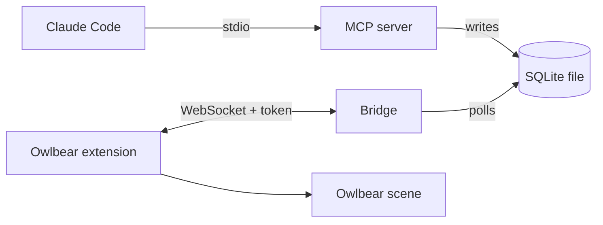

# Architecture (runtime view)

Which processes run, how they talk, and what reaches the table. For the package and dependency rules, see the Architecture section of [`CLAUDE.md`](../CLAUDE.md).

## Processes

- **MCP server**: stdio, started by Claude Code from `.mcp.json` through the launcher `packages/mcp/bin/stdio.mjs`.
- **Bridge**: `npm run bridge`, a separate process. HTTP plus WebSocket `/ws` on 127.0.0.1, default port 5199 (`BRIDGE_PORT`). It also serves the built extension (`packages/owlbear/dist`).
- **Extension**: runs in the GM's Owlbear tab and is the bridge's client.

## Shared database

Both processes use one SQLite file in WAL mode: `TTRPG_AGENTS_DB`, else `$XDG_DATA_HOME/ttrpg-agents/encounters.db`, else `~/.local/share/ttrpg-agents/encounters.db`. The MCP server writes; the bridge only reads.

## Token and auth

- The token file is `BRIDGE_TOKEN_FILE` (default `~/.config/ttrpg-agents/bridge-token`, mode 0600, created on first run).
- A `manifest.json` request with the right `?token=` gets the token put into the popover URL fragment. The extension reads it from `location.hash` and sends it in `hello`. The bridge compares it in constant time; a bad or missing token closes the socket.
- The Host header must be a loopback name with the actual port (DNS-rebinding defence), and the WebSocket upgrade must come from the bridge's own loopback origin on `/ws`.
- The `role` in `hello` only drives the extension UI and never authorizes.

## What reaches the table

The bridge polls `PRAGMA data_version` every 250 ms. When another process committed, it broadcasts an `encounter-snapshot` (the full instance list, HP included) to authenticated clients. It also sends one after each `hello-ack`.

The extension (GM role only) reconciles the scene against the latest encounter. It keeps the instances from the last snapshot, folded with the `encounter-event` messages, and fixes the difference with the scene on every snapshot, event, scene-ready change and retry after a failed apply (backoff). Nothing touches the scene until it is ready.

- **Tokens.** Our tokens carry the metadata key `com.ttrpg-agents/instance`; anything else on the scene is never touched. By default each instance is a hidden circle SHAPE token. Per-feature values are set by projectors (`owned` or `create-only`) and written one metadata key at a time, so other extensions' keys survive.
- **The table wins.** Each token records the value last written for every `owned` key (metadata key `com.ttrpg-agents/synced`). A value is pushed only when the encounter changed since then. A table edit stands until the encounter's value changes again, and then the encounter overwrites it.
- **Deleted tokens stay deleted.** The scene metadata key `com.ttrpg-agents/placed` lists the instances already placed on the scene, so a token the GM deleted is not recreated. A scene with no record is populated.
- **Not yet written back.** Table edits and token deletions do not reach the store (open tickets #162 and #163).
