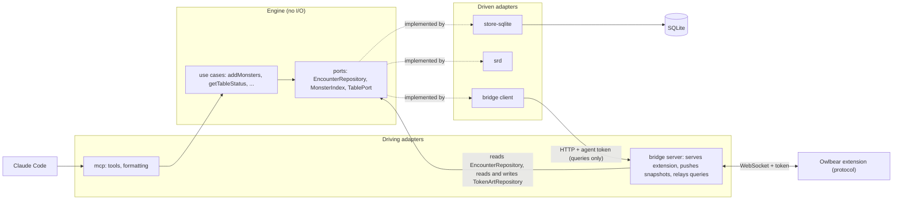
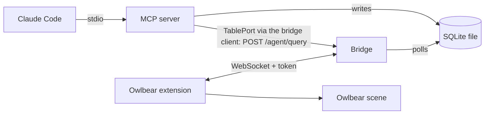

# Architecture

## Hexagon (packages and ports)

The packages and the ports between them. For the dependency rules, see the Architecture section of [`CLAUDE.md`](../CLAUDE.md).

The bridge is both sides. The server is a driving adapter: table edits become engine commands (an `instance-edit` runs the engine's `applyInstanceEdit`; a `token-deleted` calls `EncounterRepository.removeInstances` directly), and it reads the encounter through the `EncounterRepository` port and the token art through `TokenArtRepository` to push snapshots, and stores the art the extension sends. The client is a driven adapter: the driven end of `TablePort`. The mcp-to-bridge arrow in the runtime diagram below is made by the bridge client adapter that `mcp/src/stdio.ts` wires in. The channel is read-only by rule: it carries queries only, and the agent changes the game through the engine's model (see the rule in [`CLAUDE.md`](../CLAUDE.md)).

## Runtime (processes)

Which processes run, how they talk, and what reaches the table.

## Processes

- **MCP server**: stdio, started by Claude Code from `.mcp.json` through the launcher `packages/mcp/bin/stdio.mjs`. It also calls the running bridge over loopback HTTP to ask the table something (see "Queries to the table").
- **Bridge**: `npm run bridge`, a separate process. HTTP plus WebSocket `/ws` on 127.0.0.1, default port 5199 (`BRIDGE_PORT`). It also serves the built extension (`packages/owlbear/dist`).
- **Extension**: runs in the GM's Owlbear tab and is the bridge's client.

## Shared database

Both processes use one SQLite file in WAL mode: `TTRPG_AGENTS_DB`, else `$XDG_DATA_HOME/ttrpg-agents/encounters.db`, else `~/.local/share/ttrpg-agents/encounters.db`. The MCP server writes. The bridge reads, removes one instance when the extension reports (`token-deleted`) that the GM deleted its token, applies HP, max HP and armor class edited on the table (`instance-edit`), and stores the image the GM picked for a monster type (`token-art-set`, table `token_art`). Validated image bytes live in table `token_art_image`, keyed by SHA-256, with no monster key or monster link. `token_art.sha256` is an optional link to one of those images; art without a stored image has it null.

## Token and auth

- The token file is `BRIDGE_TOKEN_FILE` (default `~/.config/ttrpg-agents/bridge-token`, mode 0600, created on first run).
- A `manifest.json` request with the right `?token=` gets the token put into the popover URL fragment. The extension reads it from `location.hash` and sends it in `hello`. The bridge compares it in constant time; a bad or missing token closes the socket.
- The Host header must be a loopback name with the actual port (DNS-rebinding defence), and the WebSocket upgrade must come from the bridge's own loopback origin on `/ws`.
- The `role` in `hello` only drives the extension UI and never authorizes.
- A second, separate agent token authorises `POST /agent/query`: file `BRIDGE_AGENT_TOKEN_FILE` (default `~/.config/ttrpg-agents/agent-token`, mode 0600, created on first run). The bridge never serves it, it is not in the manifest URL, and it authorises nothing else. The extension token is rejected on that route.

## Queries to the table

Apart from the extension's write-backs (`token-deleted`, `instance-edit`, `token-art-set`), the bridge only pushes. To let the agent ask the table something (first use: `table_status`), the MCP tool calls the engine's `getTableStatus`, which asks the `TablePort`; the bridge client (`@ttrpg-agents/bridge/client`, wired in by `mcp/src/stdio.ts`) implements the port and calls `POST /agent/query` on the bridge with `Authorization: Bearer <agent token>` and a JSON query (`{"name":"scene-status"}`). The channel is read-only by rule: a query never changes the table. The route has no CORS headers, keeps the Host check, and caps the body at 1 MiB.

1. The bridge sends the query as a `query` message with a fresh id to the one active extension client.
2. The extension answers with a `query-result` carrying the same id (or a non-fatal `error` with that id if the handler threw). A reply with another or no id does not complete the call; the bridge answers it with a non-fatal `error`.
3. The bridge returns the result as the HTTP body: `{ ok: true, result }` or `{ ok: false, error: { code, message } }`.

Errors: 401 `unauthorized`, 400 `bad-request`, 503 `not-connected` (no GM tab), 504 `timeout` (no reply within 5 s), 502 `query-failed`. The bridge client adds `bridge-unreachable` when the bridge is not running or the agent token file is missing; the adapter (`createBridgeTable`) turns any `{ ok: false }` into a `TableUnavailableError`. Only one GM tab is connected at a time, so there is one recipient.

`scene-status` returns whether the scene is ready, how many of our tokens are on it, and how many instances the extension has applied. `getTableStatus` (engine) compares those with the encounter in the database to give the in-sync verdict; `table_status` only formats it.

## What reaches the table

The bridge polls `PRAGMA data_version` every 250 ms. When another process committed, it broadcasts an `encounter-snapshot` (the full instance list, HP included) to authenticated clients. It also sends one after each `hello-ack`.

The extension (GM role only) reconciles the scene against the latest encounter. It keeps the instances from the last snapshot, folded with the `encounter-event` messages, and fixes the difference with the scene on every snapshot, event, scene-ready change and retry after a failed apply (backoff). Nothing touches the scene until it is ready.

- **Tokens.** Our tokens carry the metadata key `com.ttrpg-agents/instance`; anything else on the scene is never touched. By default each instance is a hidden IMAGE token drawn with the art the GM picked from their Owlbear asset library for its monster type (asked once per type, when a token is first created for it, then remembered in the database as a VTT-neutral reference `{ url, mime, width, height }`; the extension derives an Owlbear grid with the image centred when it creates the token, its longer side spanning the instance's footprint in cells), or a hidden circle SHAPE token when there is no art (no usable pick: cancel, picker error or invalid image). The engine sets each instance's footprint from its monster's size category (small and medium 1 cell, large 2, huge 3, gargantuan 4; tiny and unknown sizes 1), and the store keeps it per instance (rows from before it existed read as 1). A new hidden circle is footprint cells wide and high, and tokens created in one batch sit side by side, each in a slot as wide as its footprint. Tokens that already exist are never resized or re-skinned. Per-feature values are set by projectors (`owned` or `create-only`) and written one metadata key at a time, so other extensions' keys survive.
- **Only the MCP writes the table.** Each token records the value last written for every `owned` key (metadata key `com.ttrpg-agents/synced`). A value is pushed only when the encounter changed since then. A table edit stands until the encounter's value changes again, and then the encounter overwrites it. An edit of HP, max HP or armor class is also written back (`instance-edit`). The table is written only for a store change caused by the MCP. The store's answer to an edit is a snapshot carrying `cause` (the edit's envelope id) and never writes to the table: the extension adopts its values as the baseline, so a clamp keeps the typed value (the panel shows a note) and a refusal shows the error. The exception is a field the store moved that differs in the answer (an MCP change, or a store clamp of another field, such as HP lowered by a max HP edit): the whole Stat Bubbles value is then pushed with the store's values (typed ones included), and no edit or note follows. A value typed and not yet sent when an older answer arrives is adopted and sent, not overwritten, unless the store also moved a field of that value (a `statsVisible` change carried by the answer counts), which pushes the store's values. After a reload a typed value is sent once more.
- **Deleted tokens stay deleted.** The scene metadata key `com.ttrpg-agents/placed` lists the instances already placed on the scene, so a token the GM deleted is not recreated. A scene with no record is populated.
- **Token deletion is written back.** A deleted token (a wanted instance in `placed` with no token) is reported to the bridge, which removes the instance from the store and replies with a fresh snapshot, so the `placed` record is pruned.

### Who owns what

Per synced value: which side has authority, and how a change on the other side reaches it. A feature that syncs a new value adds a row here in its plan.

| Value                                                | Authority                       | Table change reaches the store                                                                      | Store change reaches the table                                             |
| ---------------------------------------------------- | ------------------------------- | --------------------------------------------------------------------------------------------------- | -------------------------------------------------------------------------- |
| Instance existence                                   | store                           | A GM token deletion is written back (`token-deleted`); a deleted token is not recreated (`placed`). | A token is created for an instance not in `placed`.                        |
| HP, max HP, armor class (Stat Bubbles)               | shared                          | Written back (`instance-edit`); an armor class only when the instance has one.                      | Pushed only for an MCP-origin change (#204).                               |
| Initiative `count`                                   | store (shared once #177 lands)  | Never (#177 adds it).                                                                               | Pushed on a store change; a table edit stands until the store changes it.  |
| Initiative Tracker `active` flag                     | table                           | Never.                                                                                              | Never; carried over from the token's value.                                |
| Stat Bubbles `hide`                                  | store                           | Never.                                                                                              | Set from `statsVisible`; a table edit stands until `statsVisible` changes. |
| Token name                                           | store (rename tool)             | Never.                                                                                              | Pushed on a rename; a table rename stands until the store renames again.   |
| Position, visibility, size and art of a token        | table, after creation           | Never.                                                                                              | Create-only.                                                               |
| Token art per monster type                           | table picks, store remembers    | `token-art-set`.                                                                                    | Used when a token is created for the type.                                 |
| Map item transform                                   | table                           | Never; read by query (#184, planned).                                                               | Never.                                                                     |
| Rooms                                                | store                           | Never.                                                                                              | Never; the overlay is local and read-only (#191, planned).                 |
| `com.ttrpg-agents/synced`, `com.ttrpg-agents/placed` | the extension's own bookkeeping | Never.                                                                                              | Never.                                                                     |

### Change origin

Every change to the store carries an origin (`mcp` or `table`) and a command id. A consumer applies changes from other origins and treats changes from its own commands as acknowledgements. A consumer never writes a value to the table because the store's answer differs from what it asked: no clamp push-back and no refusal push-back (the #204 rule, stated for the general case).

- In force: the #204 rule. The table is written only for a store change caused by the MCP; the answer to an edit carries `cause` and never writes to the table.
- In force (#208, engine): every repository mutation takes a `ChangeOrigin`, and `encounterEventSchema` has an origin-carrying event for each mutation. Nothing emits those events yet.
- Lands with #128 (change log): the store records the events as an ordered, origin-tagged log; the bridge broadcasts deltas, and a snapshot only on connect or on a gap.
- Lands with #209 (extension consumer): applies deltas by origin, treats its own commands as acknowledgements, queues commands sent while the socket is down, and retires the answer snapshot, `cause` and the sent-edit memory.

Each landing removes its line.
