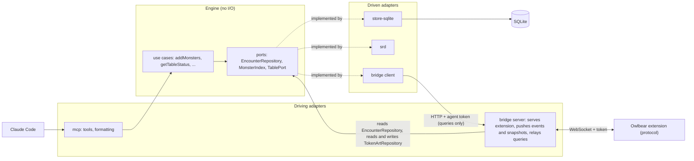
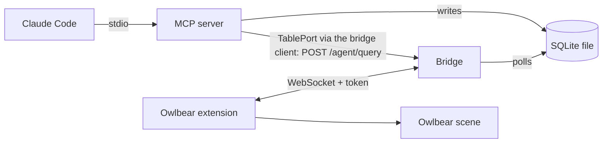

# Architecture

## Hexagon (packages and ports)

The packages and the ports between them. For the dependency rules, see the Architecture section of [`CLAUDE.md`](../CLAUDE.md).

The bridge is both sides. The server is a driving adapter: table edits become engine commands (an `instance-edit` runs the engine's `applyInstanceEdit`; a `token-deleted` calls `EncounterRepository.removeInstances` directly), and it reads the encounter through the `EncounterRepository` port and the token art through `TokenArtRepository` to build snapshots, polls the change log through the `EncounterLog` port to push events, and stores the art the extension sends. The client is a driven adapter: the driven end of `TablePort`. The mcp-to-bridge arrow in the runtime diagram below is made by the bridge client adapter that `mcp/src/stdio.ts` wires in. The channel is read-only by rule: it carries queries only, and the agent changes the game through the engine's model (see the rule in [`CLAUDE.md`](../CLAUDE.md)).

## Runtime (processes)

Which processes run, how they talk, and what reaches the table.

## Processes

- **MCP server**: stdio, started by Claude Code from `.mcp.json` through the launcher `packages/mcp/bin/stdio.mjs`. It also calls the running bridge over loopback HTTP to ask the table something (see "Queries to the table").
- **Bridge**: `npm run bridge`, a separate process. HTTP plus WebSocket `/ws` on 127.0.0.1, default port 5199 (`BRIDGE_PORT`). It also serves the built extension (`packages/owlbear/dist`).
- **Extension**: runs in the GM's Owlbear tab and is the bridge's client.

## Shared database

Both processes use one SQLite file in WAL mode: `TTRPG_AGENTS_DB`, else `$XDG_DATA_HOME/ttrpg-agents/encounters.db`, else `~/.local/share/ttrpg-agents/encounters.db`. The MCP server writes. The bridge reads, removes one instance when the extension reports (`token-deleted`) that the GM deleted its token, applies HP, max HP, armor class and initiative edited on the table (`instance-edit`), and stores the image the GM picked for a monster type (`token-art-set`, table `token_art`). Validated image bytes live in table `token_art_image`, keyed by SHA-256, with no monster key or monster link. `token_art.sha256` is an optional link to one of those images; art without a stored image has it null.

## Token and auth

- The token file is `BRIDGE_TOKEN_FILE` (default `~/.config/ttrpg-agents/bridge-token`, mode 0600, created on first run).
- A `manifest.json` request with the right `?token=` gets the token put into the popover URL fragment. The extension reads it from `location.hash` and sends it in `hello`. The bridge compares it in constant time; a bad or missing token closes the socket.
- The Host header must be a loopback name with the actual port (DNS-rebinding defence), and the WebSocket upgrade must come from the bridge's own loopback origin on `/ws`.
- The `role` in `hello` only drives the extension UI and never authorizes.
- A second, separate agent token authorises `POST /agent/query`: file `BRIDGE_AGENT_TOKEN_FILE` (default `~/.config/ttrpg-agents/agent-token`, mode 0600, created on first run). The bridge never serves it, it is not in the manifest URL, and it authorises nothing else. The extension token is rejected on that route.

## Queries to the table

Apart from the extension's write-backs (`token-deleted`, `instance-edit`, `token-art-set`), the bridge only pushes. To let the agent ask the table something (first use: `table_status`), the MCP tool calls the engine's `getTableStatus`, which asks the `TablePort`; the bridge client (`@ttrpg-agents/bridge/client`, wired in by `mcp/src/stdio.ts`) implements the port and calls `POST /agent/query` on the bridge with `Authorization: Bearer <agent token>` and a JSON query (`{"name":"scene-status"}`). The channel is read-only by rule: a query never changes the table. The route has no CORS headers, keeps the Host check, and caps the body at 1 MiB.

1. The bridge sends the query as a `query` message with a fresh id to the one active extension client.
2. The extension answers with a `query-result` carrying the same id (or a non-fatal `error` with that id if the handler threw). A reply with another or no id does not complete the call; the bridge answers it with a non-fatal `error`.
3. The bridge returns the result as the HTTP body: `{ ok: true, result }` or `{ ok: false, error: { code, message } }`.

Errors: 401 `unauthorized`, 400 `bad-request`, 503 `not-connected` (no GM tab), 504 `timeout` (no reply within 5 s), 502 `query-failed`. The bridge client adds `bridge-unreachable` when the bridge is not running or the agent token file is missing; the adapter (`createBridgeTable`) turns any `{ ok: false }` into a `TableUnavailableError`. Only one GM tab is connected at a time, so there is one recipient.

`scene-status` returns whether the scene is ready, how many of our tokens are on it, and how many instances the extension has applied. `getTableStatus` (engine) compares those with the encounter in the database to give the in-sync verdict; `table_status` only formats it.

## What reaches the table

The bridge polls the change log every 250 ms and broadcasts each new event to authenticated clients as an `encounter-event` carrying its `seq`, oldest first. Only events committed after the bridge started are read. The poll sees every commit, the MCP server's and the bridge's own write-backs. A row the bridge cannot parse (for example one written by a newer MCP server) comes back from `EncounterLog.eventsSince` as an unreadable entry in its place; the bridge reports it once and sends every client a snapshot instead.

A client that connects gets an `encounter-snapshot` (the full instance list, HP included, plus the `seq` it is current as of) after the `hello-ack`. The extension's own commands (`instance-edit`, `token-deleted`, `token-art-set`) get no snapshot in reply: the `table` events of an accepted edit or removal carry its envelope id as their command id and are its answer, and a refusal is a non-fatal `error` with that id. A `token-art-set` gets no answer when accepted (it has no envelope id); a failed write is a non-fatal `token-art-failed` `error` without one. There is no resume: a client that reconnects gets a new snapshot.

The extension (GM role only) reconciles the scene against the latest encounter. It keeps the instances from the last snapshot, folded with later events of both origins in `seq` order, and fixes the difference with the scene on every snapshot, applied event, scene-ready change and retry after a failed apply (backoff). It ignores an event it already has (a `seq` at or before the last one). It applies deltas by origin: an `mcp` event writes the fields it changes to the table, and a `table` event is the store's answer to a command (see the rules below). When an event skips a `seq`, it applies nothing and reconnects for a snapshot. Nothing touches the scene until it is ready.

- **Tokens.** Our tokens carry the metadata key `com.ttrpg-agents/instance`; anything else on the scene is never touched. By default each instance is a hidden IMAGE token drawn with the art the GM picked from their Owlbear asset library for its monster type (asked once per type, when a token is first created for it, then remembered in the database as a VTT-neutral reference `{ url, mime, width, height }`; the extension derives an Owlbear grid with the image centred when it creates the token, its longer side spanning the instance's footprint in cells), or a hidden circle SHAPE token when there is no art (no usable pick: cancel, picker error or invalid image). The engine sets each instance's footprint from its monster's size category (small and medium 1 cell, large 2, huge 3, gargantuan 4; tiny and unknown sizes 1), and the store keeps it per instance (rows from before it existed read as 1). A new hidden circle is footprint cells wide and high, and tokens created in one batch sit side by side, each in a slot as wide as its footprint. Tokens that already exist are never resized or re-skinned. Per-feature values are set by projectors (`owned` or `create-only`) and written one metadata key at a time, so other extensions' keys survive.
- **Only the MCP writes the table.** Each token records the value last written for every `owned` key (metadata key `com.ttrpg-agents/synced`). A value is pushed only when the encounter changed since then. A table edit stands until the encounter's value changes again, and then the encounter overwrites it. An edit of HP, max HP, armor class or the tracker's initiative `count` is also written back (`instance-edit`, one command per field), and these fields are decided one by one. A write-back is sent only after the value has stayed unchanged for 1.5 s (a later value restarts the delay; an `mcp` change of the field meanwhile drops the held edit), and an unreadable value is reported in the panel only if it is still unreadable after the same delay. Removing a token from the tracker clears the instance's initiative, and a count on a token whose instance has none is adopted. The table is written only for a store change caused by the MCP: an `mcp` event that changes a field pushes it, even over a table edit, unless an edit of that field is still queued or unacknowledged (that edit commits after the event, so the store ends at the typed value too). The answer to an edit (its `table` event) never writes the field it set to the table: the token keeps the typed value and the baseline records it, so a clamp is not sent again (the panel shows a note), and a refusal is recorded the same way and shows the error. A field the edit did not set that the store changed (HP lowered by a max HP edit) is pushed. A `table` event with a command id the extension does not know (one sent before a reload) records the store's values as the baseline. A snapshot (connect, reconnect after a gap, or in place of an unreadable change-log row on the same connection) pushes each field whose store value differs from the baseline, unless an edit of it is in flight, so a clamped value kept on the table gives way to the store's at the next snapshot. Each such push over a different token value is listed in the panel (instance, field, the table's value and the store's) until the DM dismisses the list, because a snapshot cannot tell an MCP change made meanwhile from an overridden clamp; the list is kept in memory only. A snapshot on the same connection may cover the answers of edits already sent, which then never arrive, so the extension forgets those edits; one the store has not applied yet is sent again (edits are absolute). After a reload a typed value the store does not hold is sent again, unless the store's value changed since the last write.
- **Commands wait for the bridge.** A table edit, token deletion or art pick made while the socket is down is queued in the extension (the panel counts what waits) and sent in order after the next `hello-ack`, before the snapshot that follows is applied. A command is remembered until its `table` event or refusal arrives; one sent on a connection that has since dropped is forgotten at the next snapshot, so a lost one is noticed and sent again. An art pick gets no answer, so it is forgotten at the snapshot that follows the next `hello-ack` and is not sent again; a pick lost in flight (taken by the socket but never stored) is not resent.
- **Deleted tokens stay deleted.** The scene metadata key `com.ttrpg-agents/placed` lists the instances already placed on the scene, so a token the GM deleted is not recreated. A scene with no record is populated.
- **Token deletion is written back.** A deleted token (a wanted instance in `placed` with no token) is reported to the bridge, which removes the instance from the store. The `table` event for the removal acknowledges the command and removes the instance from the extension's encounter, so the `placed` record is pruned. A deletion in flight is not reported again.

### Who owns what

Per synced value: which side has authority, and how a change on the other side reaches it. A feature that syncs a new value adds a row here in its plan.

| Value                                                | Authority                       | Table change reaches the store                                                                                                                                      | Store change reaches the table                                                                                                                                              |
| ---------------------------------------------------- | ------------------------------- | ------------------------------------------------------------------------------------------------------------------------------------------------------------------- | --------------------------------------------------------------------------------------------------------------------------------------------------------------------------- |
| Instance existence                                   | store                           | A GM token deletion is written back (`token-deleted`); a deleted token is not recreated (`placed`).                                                                 | A token is created for an instance not in `placed`.                                                                                                                         |
| HP, max HP, armor class (Stat Bubbles)               | shared                          | Written back (`instance-edit`) after it has stayed unchanged for 1.5 s; an armor class only when the instance has one.                                              | Pushed per field for an `mcp` event that changes it, unless an edit of it is in flight; a snapshot pushes a value that differs from the baseline and lists it in the panel. |
| Initiative `count`                                   | shared                          | Written back (`instance-edit`) after it has stayed unchanged for 1.5 s; a token removed from the tracker clears it, and a count for a monster with none is adopted. | Pushed for an `mcp` event that changes it, unless an edit of it is in flight; a snapshot pushes a value that differs from the baseline and lists it in the panel.           |
| Initiative Tracker `active` flag                     | table                           | Never.                                                                                                                                                              | Never; carried over from the token's value.                                                                                                                                 |
| Stat Bubbles `hide`                                  | store                           | Never.                                                                                                                                                              | Set from `statsVisible`; a table edit stands until `statsVisible` changes.                                                                                                  |
| Token name                                           | store (rename tool)             | Never.                                                                                                                                                              | Pushed on a rename; a table rename stands until the store renames again.                                                                                                    |
| Position, visibility, size and art of a token        | table, after creation           | Never.                                                                                                                                                              | Create-only.                                                                                                                                                                |
| Token art per monster type                           | table picks, store remembers    | `token-art-set`.                                                                                                                                                    | Used when a token is created for the type.                                                                                                                                  |
| Map item transform                                   | table                           | Never; read by query (#184, planned).                                                                                                                               | Never.                                                                                                                                                                      |
| Rooms                                                | store                           | Never.                                                                                                                                                              | Never; the overlay is local and read-only (#191, planned).                                                                                                                  |
| `com.ttrpg-agents/synced`, `com.ttrpg-agents/placed` | the extension's own bookkeeping | Never.                                                                                                                                                              | Never.                                                                                                                                                                      |

### Change origin

Every change to the store carries an origin (`mcp` or `table`) and a command id. A consumer applies changes from other origins and treats changes from its own commands as acknowledgements. A consumer never writes a value to the table because the store's answer differs from what it asked: no clamp push-back and no refusal push-back (the #204 rule, stated for the general case). The one exception is a snapshot: it has no origin, so it writes the store's value over a value kept on the token (a clamp or a refusal) and the extension lists each such write in the panel's override list (#209, option (a), decided by Tony).

- In force: the #204 rule. The table is written only for a store change caused by the MCP, or by a snapshot (the exception above); the answer to an edit (the `table` event carrying its command id) never writes the field it set to the table.
- In force (#208, engine): every repository mutation takes a `ChangeOrigin`, and `encounterEventSchema` has an origin-carrying event for each mutation. The store records each event, with its origin, in an ordered log (`encounter_events`, read through the engine's `EncounterLog` port; #128), and the bridge polls it (#224).
- In force (#224, #209, bridge and extension): the bridge broadcasts the log as ordered `encounter-event`s with `seq`; a snapshot carries the `seq` it is current as of and is sent on connect (or in place of an unreadable row), never as the answer to a command. The extension applies events in `seq` order by origin, ignores duplicates, and reconnects for a snapshot on a gap; it treats the `table` events of its own commands as acknowledgements and queues commands while the socket is down.
